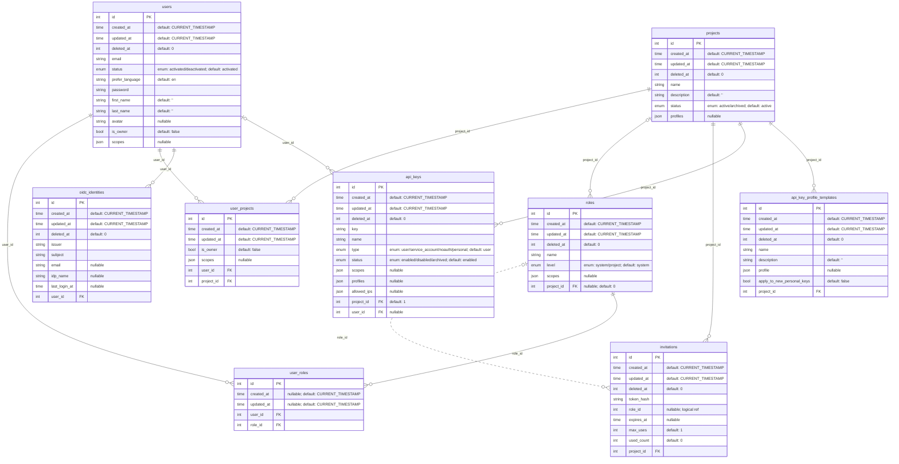
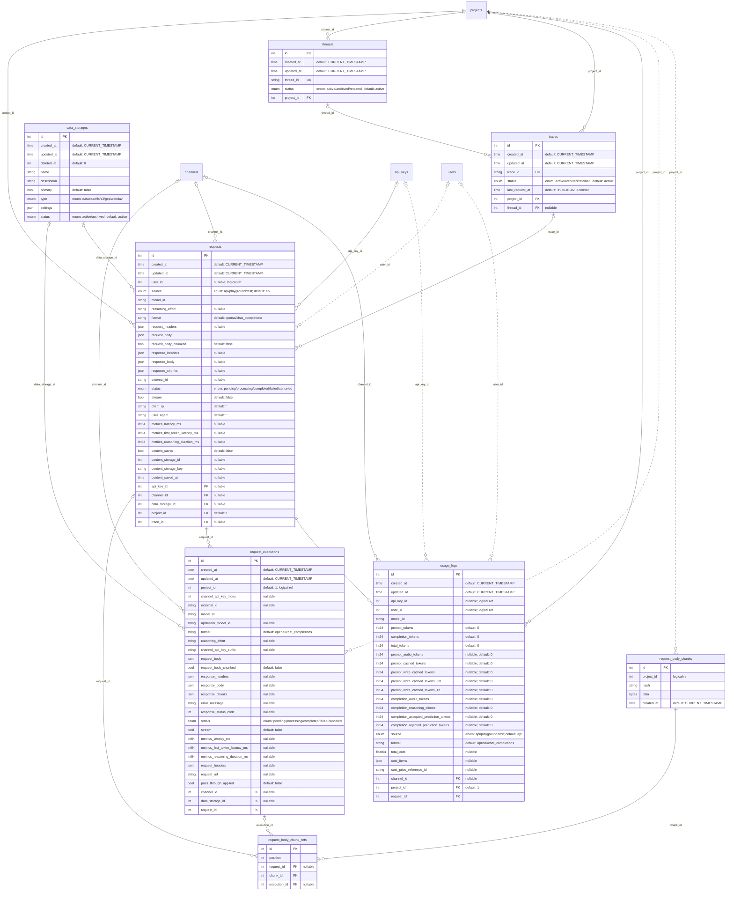
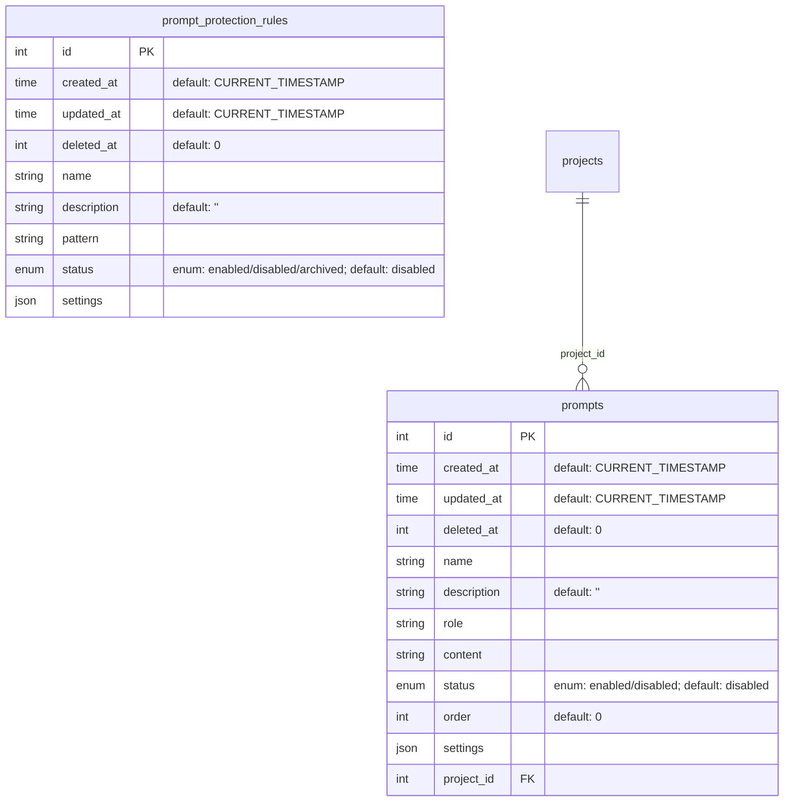
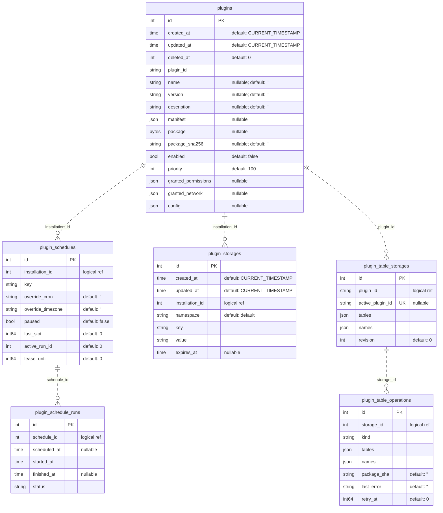
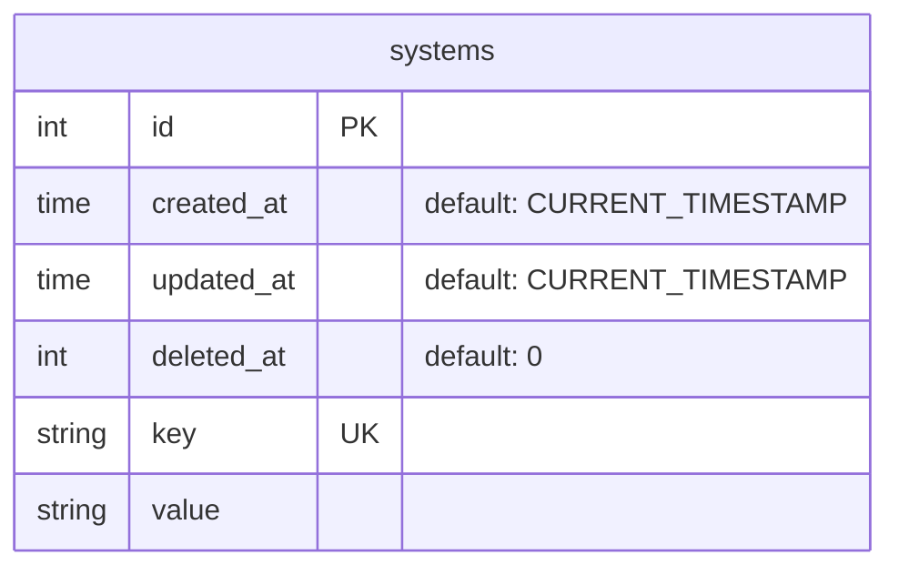

# AxonHub Database Tables

This document lists the columns and relationships of all 33 tables, grouped by data domain, as Mermaid ER diagrams. If you only need how entities relate, see the [Entity Relationship Diagram (ERD)](erd.md).

It is exported from the Ent target schema in `internal/ent/migrate` (`migrate.Tables`), which is the definition Atlas diffs against when generating versioned migrations. It is not updated automatically when the schema changes; `internal/ent/schema/` is the source of truth.

## How to read

- A solid line (`--`) is a database foreign key. A dashed line (`..`) is a logical reference: the column stores another table's ID, but there is no foreign key constraint.
- `o|` means optional (zero or one), `||` means required (exactly one), `o{` means zero or more.
- Column markers: `PK` is the primary key, `FK` is a foreign key column, `UK` is a unique column. In comments, `nullable` means the column may be null, `enum:` lists the allowed values, `default:` gives the default, and `logical ref` marks a logical reference column.
- Types come from Ent: `time` is a timestamp, `json` is a JSON column, and `enum` is an enum stored as a string.
- Most business tables have `created_at` and `updated_at`; soft-deleted tables also have `deleted_at` (0 means not deleted).
- Each domain diagram shows only references from its own tables; referenced tables from other domains appear by name only, without columns.

## Overview

Table-to-table relationships only, without columns.

```mermaid
erDiagram
    projects ||--o{ api_key_profile_templates : project_id
    projects ||--o{ api_keys : project_id
    users o|--o{ api_keys : user_id
    channel_model_prices ||--o{ channel_model_price_versions : channel_model_price_id
    channels ||--o{ channel_model_prices : channel_id
    users o|--o{ channel_override_templates : user_id
    channels ||--o{ channel_probes : channel_id
    projects ||--o{ invitations : project_id
    users ||--o{ oidc_identities : user_id
    projects ||--o{ prompts : project_id
    channels ||--o| provider_quota_status : channel_id
    requests o|--o{ request_body_chunk_refs : request_id
    request_body_chunks ||--o{ request_body_chunk_refs : chunk_id
    request_executions o|--o{ request_body_chunk_refs : execution_id
    channels o|--o{ request_executions : channel_id
    data_storages o|--o{ request_executions : data_storage_id
    requests ||--o{ request_executions : request_id
    api_keys o|--o{ requests : api_key_id
    channels o|--o{ requests : channel_id
    data_storages o|--o{ requests : data_storage_id
    projects ||--o{ requests : project_id
    traces o|--o{ requests : trace_id
    projects o|--o{ roles : project_id
    projects ||--o{ threads : project_id
    projects ||--o{ traces : project_id
    threads o|--o{ traces : thread_id
    channels o|--o{ usage_logs : channel_id
    projects ||--o{ usage_logs : project_id
    requests ||--o{ usage_logs : request_id
    users ||--o{ user_projects : user_id
    projects ||--o{ user_projects : project_id
    users ||--o{ user_roles : user_id
    roles ||--o{ user_roles : role_id
    users o|..o{ requests : user_id
    users o|..o{ usage_logs : user_id
    api_keys o|..o{ usage_logs : api_key_id
    projects ||..o{ request_executions : project_id
    projects ||..o{ request_body_chunks : project_id
    roles o|..o{ invitations : role_id
    channels ||..o{ channel_model_price_versions : channel_id
    plugins ||..o{ plugin_schedules : installation_id
    plugins ||..o{ plugin_storages : installation_id
    plugin_schedules ||..o{ plugin_schedule_runs : schedule_id
    plugin_table_storages ||..o{ plugin_table_operations : storage_id
    plugins ||..o{ plugin_table_storages : plugin_id
```

## Identity and access

Users, projects, memberships, roles, API keys, login identities, and invitations.

## Channels and models

Upstream provider channels, model definitions, channel pricing and its history, channel probes, and quota status.

```mermaid
erDiagram
    channels {
        int id PK
        time created_at "default: CURRENT_TIMESTAMP"
        time updated_at "default: CURRENT_TIMESTAMP"
        int deleted_at "default: 0"
        enum type "enum: openai/openai_responses/atlascloud/cline/codex/vercel/anthropic/anthropic_aws/anthropic_gcp/gemini_openai/gemini/gemini_vertex/deepseek/deepseek_anthropic/deepinfra/qiniu/fireworks/doubao/doubao_anthropic/moonshot/moonshot_anthropic/zhipu/zai/zhipu_anthropic/zai_anthropic/anthropic_fake/openai_fake/openrouter/xiaomi/xiaomi_anthropic/xai/xai_responses/xai_subscription/ppio/siliconflow/volcengine/volcengine_anthropic/longcat/longcat_anthropic/minimax/minimax_anthropic/aihubmix/aihubmix_anthropic/burncloud/modelscope/bailian/bailian_responses/bailian_anthropic/moonshot_coding/jina/github/github_copilot/claudecode/cerebras/antigravity/nanogpt/nanogpt_responses/opencode_go/opencode_go_anthropic/ollama/ollama_anthropic/evolink/evolink_anthropic/groq/qiniu_anthropic/fenno/zenmux/zenmux_responses/zenmux_anthropic/zenmux_gemini/zenmux_video/commandcode/commandcode_anthropic/typesafe/cloudflare"
        string base_url "nullable"
        string name
        enum status "enum: enabled/disabled/archived; default: disabled"
        json credentials
        json disabled_api_keys "nullable"
        json supported_models
        json manual_models "nullable"
        bool auto_sync_supported_models "default: false"
        string auto_sync_model_pattern "nullable; default: ''"
        json tags "nullable"
        string default_test_model
        json policies "nullable"
        json settings "nullable"
        int ordering_weight "default: 0"
        string error_message "nullable"
        time auto_disabled_at "nullable"
        time auto_disable_expires_at "nullable"
        string remark "nullable"
        json endpoints "nullable"
    }
    models {
        int id PK
        time created_at "default: CURRENT_TIMESTAMP"
        time updated_at "default: CURRENT_TIMESTAMP"
        int deleted_at "default: 0"
        string developer
        string model_id
        enum type "enum: chat/embedding/rerank/image_generation/video_generation; default: chat"
        string name
        string icon
        string group
        json model_card
        json settings
        enum status "enum: enabled/disabled/archived; default: disabled"
        string remark "nullable"
    }
    channel_model_prices {
        int id PK
        time created_at "default: CURRENT_TIMESTAMP"
        time updated_at "default: CURRENT_TIMESTAMP"
        int deleted_at "default: 0"
        string model_id
        json price
        string reference_id UK
        int channel_id FK
    }
    channel_model_price_versions {
        int id PK
        time created_at "default: CURRENT_TIMESTAMP"
        time updated_at "default: CURRENT_TIMESTAMP"
        int channel_id "logical ref"
        string model_id
        json price
        enum status "enum: active/archived"
        time effective_start_at
        time effective_end_at "nullable"
        string reference_id UK
        int channel_model_price_id FK
    }
    channel_override_templates {
        int id PK
        time created_at "default: CURRENT_TIMESTAMP"
        time updated_at "default: CURRENT_TIMESTAMP"
        int deleted_at "default: 0"
        string name
        string description "nullable"
        string override_parameters
        json override_headers
        json header_override_operations "nullable"
        json body_override_operations "nullable"
        int user_id FK "nullable"
    }
    channel_probes {
        int id PK
        int total_request_count
        int success_request_count
        float64 avg_tokens_per_second "nullable"
        float64 avg_time_to_first_token_ms "nullable"
        int64 timestamp
        int channel_id FK
    }
    provider_quota_status {
        int id PK
        time created_at "default: CURRENT_TIMESTAMP"
        time updated_at "default: CURRENT_TIMESTAMP"
        int deleted_at "default: 0"
        enum provider_type "enum: claudecode/codex/antigravity/xai_subscription/github_copilot/nanogpt/cline/synthetic/neuralwatt/apertis/opencode_go/kimi_code/minimax/zhipu/zai/charm_hyper/zenmux/commandcode/deepseek/ollama"
        enum status "enum: available/warning/exhausted/unknown"
        json quota_data
        time next_reset_at "nullable"
        bool ready "default: true"
        time next_check_at
        string account_key "nullable; default: ''"
        int channel_id FK,UK
    }
    channel_model_prices ||--o{ channel_model_price_versions : channel_model_price_id
    channels ||--o{ channel_model_prices : channel_id
    users o|--o{ channel_override_templates : user_id
    channels ||--o{ channel_probes : channel_id
    channels ||--o| provider_quota_status : channel_id
    channels ||..o{ channel_model_price_versions : channel_id
```

## Requests and usage

Client requests, each upstream execution, deduplicated request body chunks, usage and cost, Thread/Trace grouping, and payload storage.

## Prompts

Project prompts and global prompt protection rules.

## Plugins

Plugin installations, schedules and their runs, plugin key-value storage, and table storage.

## System settings

Global key-value system settings.

## Logical references (no foreign key)

These columns point to other tables, but the database has no foreign key. Business code keeps them consistent on write and delete.

| Table.column | References | Nullable |
|---|---|---|
| `requests.user_id` | `users.id` | Yes |
| `usage_logs.user_id` | `users.id` | Yes |
| `usage_logs.api_key_id` | `api_keys.id` | Yes |
| `request_executions.project_id` | `projects.id` | No |
| `request_body_chunks.project_id` | `projects.id` | No |
| `invitations.role_id` | `roles.id` | Yes |
| `channel_model_price_versions.channel_id` | `channels.id` | No |
| `plugin_schedules.installation_id` | `plugins.id` | No |
| `plugin_storages.installation_id` | `plugins.id` | No |
| `plugin_schedule_runs.schedule_id` | `plugin_schedules.id` | No |
| `plugin_table_operations.storage_id` | `plugin_table_storages.id` | No |
| `plugin_table_storages.plugin_id` | `plugins.plugin_id` | No |

## Table list

| Table | Domain | Columns | References |
|---|---|---|---|
| `users` | Identity and access | 13 | - |
| `projects` | Identity and access | 8 | - |
| `user_projects` | Identity and access | 7 | `projects`, `users` |
| `roles` | Identity and access | 8 | `projects` |
| `user_roles` | Identity and access | 5 | `roles`, `users` |
| `api_keys` | Identity and access | 13 | `projects`, `users` |
| `api_key_profile_templates` | Identity and access | 9 | `projects` |
| `oidc_identities` | Identity and access | 10 | `users` |
| `invitations` | Identity and access | 10 | `projects`, `roles` |
| `channels` | Channels and models | 24 | - |
| `models` | Channels and models | 14 | - |
| `channel_model_prices` | Channels and models | 8 | `channels` |
| `channel_model_price_versions` | Channels and models | 11 | `channel_model_prices`, `channels` |
| `channel_override_templates` | Channels and models | 11 | `users` |
| `channel_probes` | Channels and models | 7 | `channels` |
| `provider_quota_status` | Channels and models | 12 | `channels` |
| `requests` | Requests and usage | 31 | `api_keys`, `channels`, `data_storages`, `projects`, `traces`, `users` |
| `request_executions` | Requests and usage | 29 | `channels`, `data_storages`, `projects`, `requests` |
| `request_body_chunks` | Requests and usage | 5 | `projects` |
| `request_body_chunk_refs` | Requests and usage | 5 | `request_body_chunks`, `request_executions`, `requests` |
| `usage_logs` | Requests and usage | 26 | `api_keys`, `channels`, `projects`, `requests`, `users` |
| `traces` | Requests and usage | 8 | `projects`, `threads` |
| `threads` | Requests and usage | 6 | `projects` |
| `data_storages` | Requests and usage | 10 | - |
| `prompts` | Prompts | 12 | `projects` |
| `prompt_protection_rules` | Prompts | 9 | - |
| `plugins` | Plugins | 16 | - |
| `plugin_schedules` | Plugins | 9 | `plugins` |
| `plugin_schedule_runs` | Plugins | 6 | `plugin_schedules` |
| `plugin_storages` | Plugins | 8 | `plugins` |
| `plugin_table_storages` | Plugins | 6 | `plugins` |
| `plugin_table_operations` | Plugins | 8 | `plugin_table_storages` |
| `systems` | System settings | 6 | - |
