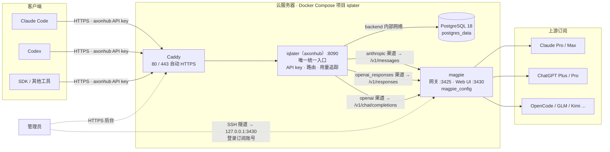
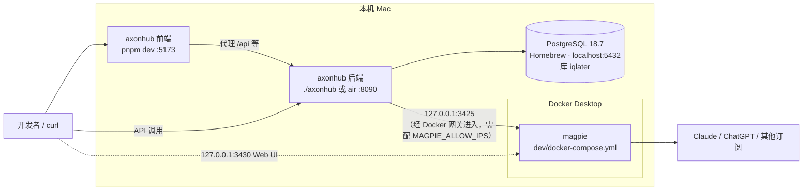

# iqlater 设计文档（axonhub 版）

日期：2026-11-27

取代基于 new-api 的旧设计（旧仓库已删除，旧工作区留在 `/Users/a123/projects/iqlater-newapi`，
其中 magpie 额度看板代码和 `deploy/` 可作参考）。

## 1. 目标与范围

iqlater 把多个大模型订阅汇总到一个统一入口。由三部分组成：

| 组成 | 来源 | 角色 |
| :-- | :-- | :-- |
| iqlater 本体 | fork 自 [looplj/axonhub](https://github.com/looplj/axonhub)，仓库 `luruxian/iqlater` | **唯一统一入口**：客户端只连它，负责 API key、路由、用量追踪 |
| magpie | [yetone/magpie](https://github.com/yetone/magpie) 官方镜像，不修改 | axonhub 的**上游渠道**：登录各订阅账号并对外提供兼容接口 |
| PostgreSQL 18 | 开发用宿主机 Homebrew；部署用官方镜像 | 仅供 axonhub 使用 |

### 本期范围

- 本地开发环境：axonhub 直接在本机运行（不用 Docker），magpie 在 Docker 中运行，数据库用宿主机 PG 18。
- magpie 作为渠道接入 axonhub，客户端通过 axonhub 使用 Claude、ChatGPT（Codex）等订阅。
- 部署编排：Caddy + axonhub + magpie + PostgreSQL 18，全部 Docker Compose，单台云服务器。
- 镜像：GitHub Actions 从 fork 构建并推送 `ghcr.io/luruxian/iqlater`。
- 品牌：通过 axonhub 配置 `server.name` 设为 `iqlater`。

### 不在本期范围（后续追加）

- **对外运营**：开放注册、余额、充值与支付、按量扣费。axonhub 目前没有这些功能（用户由邀请、项目、角色管理），
  后续在 fork 中开发。本期不改 axonhub 的数据模型，以便日后在干净的基础上追加。
- **magpie 额度看板**：本期在 magpie 的 Web UI 中查看额度；旧工作区的看板实现可在后续移植。
- **Gemini CLI、Antigravity**：不接入（Google 账号限制与封号风险）。
- 多节点 / Kubernetes。

### 1.1 上游订阅（在 magpie 中登录）

| 订阅 | magpie 接入方式 | 客户端经 axonhub 使用的协议 |
| :-- | :-- | :-- |
| Claude Pro / Max | OAuth 登录（粘贴授权码），容器内执行 `magpie claude-code install` | Anthropic Messages |
| ChatGPT Plus / Pro（Codex） | OAuth 登录（粘贴 `localhost:1455` 回调地址） | OpenAI Responses |
| OpenCode Go / Zen、GLM Coding Plan、Kimi Code 等 | 粘贴 API key | OpenAI Chat Completions 或 Anthropic Messages |

axonhub 自身也有 `claudecode`、`codex` 等订阅渠道类型。本期统一由 magpie 登录订阅，axonhub 不直接持有订阅凭据，
这样订阅登录、多账号故障切换都集中在 magpie。

## 2. 约束与风险

- **许可证**：axonhub 主体为 Apache-2.0，`llm/` 为 LGPL-3.0（见 `NOTICE`）。可以改名和品牌化；
  必须保留 `LICENSE`、`NOTICE` 和文件中的版权声明，修改过的文件需注明已修改（Apache-2.0 第 4 条）。
- **上游项目约定**：遵守 axonhub 的 `AGENTS.md` 与 `.agents/rules/`（新增 Go/TS 文件写文件头、Ent/GraphQL 代码生成、
  `docs/` 中英文同步等）。本期基本不改代码，这些规则主要约束后续开发。
- **Go 版本**：axonhub 要求 Go 1.27.4。本机为 1.26.10，`GOTOOLCHAIN=auto` 会在首次构建时自动下载 1.27.4。
- **厂商条款**：经平台转用个人订阅可能违反厂商条款，存在封号风险；magpie 的多账号故障切换只能降低单个账号失效的影响。
- **magpie 发版频繁**：部署使用 `stable` 标签；axonhub 对 magpie 的依赖只限于它的兼容接口。
- **上游 axonhub 仍是 RC 版**（最新发布 `v1.0.0-rc.5`）：fork 跟随上游发布标签，不跟随 `unstable` 分支。

## 3. 整体架构

部署（单台云服务器，全部 Docker Compose）：

### 3.1 本地开发

| 组件 | 运行方式 | 地址 |
| :-- | :-- | :-- |
| axonhub 后端 | 本机：`make build-backend && ./axonhub`，或 `air` 热重载 | `http://localhost:8090` |
| axonhub 前端 | 本机：`cd frontend && pnpm install && pnpm dev` | `http://localhost:5173`（转发到 8090） |
| PostgreSQL 18.7 | 宿主机 Homebrew（`brew services`） | `localhost:5432`，库 `iqlater`、用户 `iqlater`（带密码） |
| magpie | Docker：`dev/docker-compose.yml` | 网关 `127.0.0.1:3425`，Web UI `127.0.0.1:3430` |

- axonhub 用仓库根目录的 `config.yml`（不提交，提交 `dev/config.example.yml` 作模板）：
  `db.dialect: postgres`、`db.dsn: postgres://iqlater:<密码>@localhost:5432/iqlater?sslmode=disable`、`server.name: iqlater`。
- 本机 axonhub 经 Docker Desktop 端口映射访问 magpie 时，magpie 看到的来源 IP 是该 Docker 网络的网关地址
  （实测默认网络为 `172.17.0.1`）。`dev/docker-compose.yml` 固定子网 `172.29.0.0/24`，`MAGPIE_ALLOW_IPS=172.29.0.1`；
  放行的地址仍需携带 gateway key。
- 已验证：容器可经 `host.docker.internal:5432` 连接宿主机 PG，PG 看到的来源为 `127.0.0.1`，无需修改 PG 配置
  （本地若需要把 axonhub 也放进容器调试时可用）。

### 3.2 部署（单台云服务器）

`deploy/iqlater/docker-compose.yml`（上游 `deploy/` 下已有安装脚本与 helm，本项目文件单独放一个子目录），项目名 `iqlater`：

| 服务 | 镜像 | 对外端口 | 数据卷 |
| :-- | :-- | :-- | :-- |
| caddy | `caddy:2` | 80、443 | `caddy_data`、`caddy_config` |
| axonhub | `ghcr.io/luruxian/iqlater:${IQLATER_VERSION}` | 无（仅 Caddy 访问 8090） | 无（状态在 PG） |
| magpie | `ghcr.io/yetone/magpie:stable` | `127.0.0.1:3430`（Web UI，仅 SSH 隧道） | `magpie_config:/config` |
| postgres | `postgres:18` | 无 | `postgres_data:/var/lib/postgresql` |

- 不使用上游根目录的 `docker-compose.yml`：它把 PG 18 的数据卷挂在 `/var/lib/postgresql/data`（PG 18 起应挂在
  `/var/lib/postgresql`），且不含 magpie 与 Caddy。保留上游文件不动，避免合并冲突。
- 沿用上游 compose 的加固项：axonhub 以 `65532:65532` 运行、只读根文件系统、`cap_drop: ALL`、`no-new-privileges`。
- 网络：`backend`（`internal: true`，axonhub ↔ postgres）；`egress`（axonhub ↔ magpie、Caddy，magpie 可出网）。
- 健康检查与启动顺序：postgres（`pg_isready`）、magpie（`/magpie healthcheck`）健康后启动 axonhub（`/health`），再启动 Caddy。
- 缓存使用 axonhub 默认的内存缓存，单节点不需要 Redis。
- 优雅停止：magpie `MAGPIE_DRAIN=300`、`stop_grace_period: 310s`；axonhub 进程停止超时为 30 秒（`fx.StopTimeout`），
  `stop_grace_period: 35s`；
  Caddy `reverse_proxy` 设 `flush_interval -1` 保证流式输出。
- axonhub 的 `server.trusted_proxies` 设为 compose 子网，使其从 Caddy 的 `X-Forwarded-For` 取客户端 IP。

### 3.3 magpie 渠道接入

在 axonhub 后台为 magpie 建三个渠道，Base URL 均为 magpie 网关（开发 `http://127.0.0.1:3425`，部署 `http://magpie:3425`）：

| axonhub 渠道类型 | magpie 接口 | 用途 |
| :-- | :-- | :-- |
| `anthropic` | `/v1/messages` | Claude 订阅（Claude Code 客户端） |
| `openai_responses` | `/v1/responses` | ChatGPT / Codex 订阅（Codex 客户端） |
| `openai` | `/v1/chat/completions` | 其他按 key 套餐、通用 SDK |

- 渠道密钥使用 magpie 的完整权限 gateway key（`magpie gateway-key add iqlater`）。
- 模型列表由 axonhub 渠道的模型同步从 magpie `/v1/models` 获取；具体同步方式在实施时按 axonhub 渠道表单确认。
- 客户端只拿 axonhub 的 API key，magpie 的 gateway key 只存在 axonhub 渠道配置中。

### 3.4 仓库与分支

- `luruxian/iqlater`：fork 自 `looplj/axonhub`，`upstream` 指向上游。
- 新建 `main` 分支，基于上游最新发布标签 `v1.0.0-rc.5`，设为默认分支；本项目的提交都在 `main`。
- 跟进上游：上游发布新标签后 `git merge <tag>` 到 `main`。
- 停用 fork 上上游的发布类 workflow（Docker Hub 推送、桌面版发布、Helm 等），只保留测试与 lint，加上本项目的镜像 workflow。

### 3.5 镜像构建

- `.github/workflows/iqlater-image.yml`：推送 `iqlater-v*` 标签时，用仓库自带 `Dockerfile` 构建并推送
  `ghcr.io/luruxian/iqlater:<标签>` 与 `latest`（`linux/amd64`），手动触发只跑测试。
- action 版本沿用上游 workflow 中固定的 commit SHA。
- 首次推送后把 GHCR 包设为公开，服务器无需登录即可拉取。

## 4. 配置与密钥

部署 `deploy/iqlater/.env`（不提交，提交 `.env.example`）：

| 变量 | 说明 |
| :-- | :-- |
| `DOMAIN` | 对外域名，Caddy 自动申请证书 |
| `IQLATER_VERSION` | 镜像标签，如 `iqlater-v0.1.0` |
| `POSTGRES_PASSWORD` | PG 密码 |
| `MAGPIE_WEB_KEY` | magpie Web UI 访问 key |
| `BACKUP_PASSPHRASE`、`BACKUP_RCLONE_REMOTE` | 备份加密口令、可选的远程存储 |

axonhub 通过环境变量配置：`AXONHUB_DB_DIALECT=postgres`、`AXONHUB_DB_DSN`、`AXONHUB_SERVER_NAME=iqlater`、
`AXONHUB_SERVER_TRUSTED_PROXIES`。管理员账号在首次访问时按 axonhub 的初始化流程创建。

## 5. 备份

沿用旧方案的备份脚本，放在 `deploy/iqlater/scripts/backup.sh`：每日 `pg_dump` 与 magpie 配置卷（排除 `cache`）分别用 openssl 加密，
本地保留 7 份，可选 rclone 上传。恢复说明写在脚本头部（恢复 magpie 后需重新执行 `magpie claude-code install`）。

## 6. 验证

- 本地：axonhub 连宿主机 PG 启动并完成初始化；magpie 登录至少一个订阅；经 axonhub 用 curl 分别调用
  Anthropic Messages 与 OpenAI Responses 成功，axonhub 后台能看到请求记录与用量。
- 部署编排：`docker compose config` 通过；在本机用本地构建的镜像完整起一遍 compose（不启 Caddy），重复上述调用。
- 镜像 workflow：手动触发只跑测试并通过；推标签后镜像出现在 GHCR。
- 备份：执行一次备份并完成一次恢复演练。
