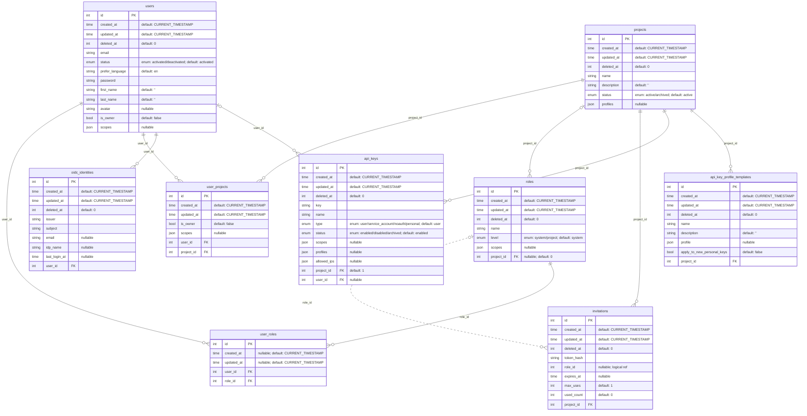
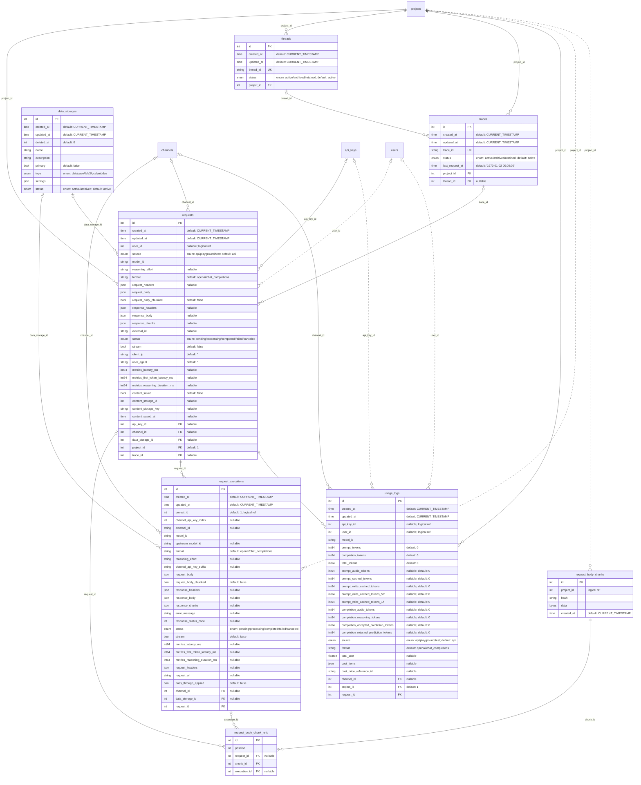
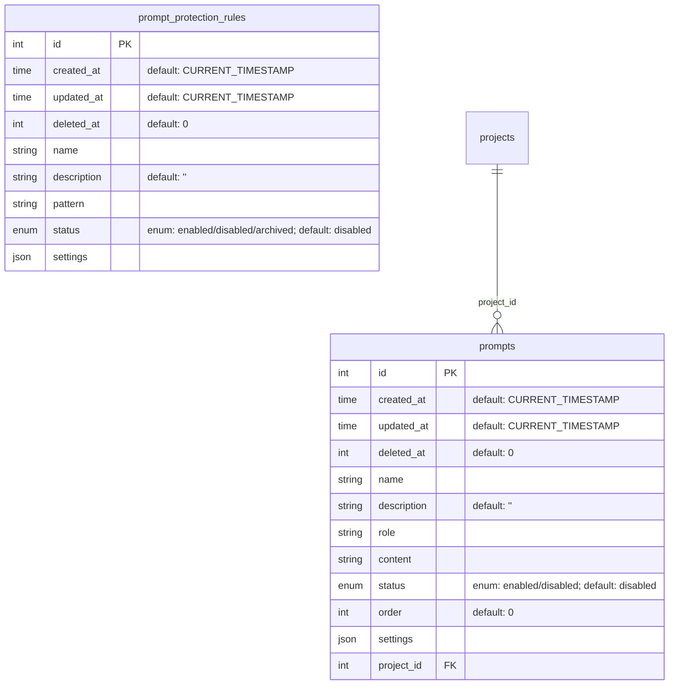
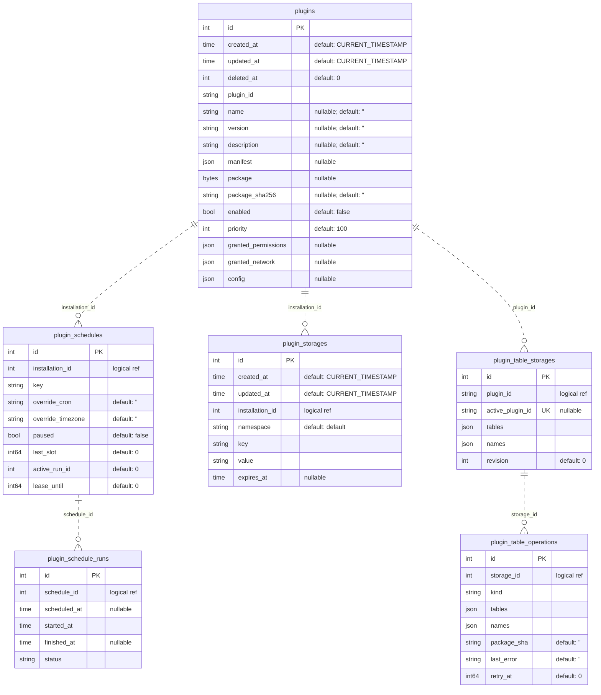
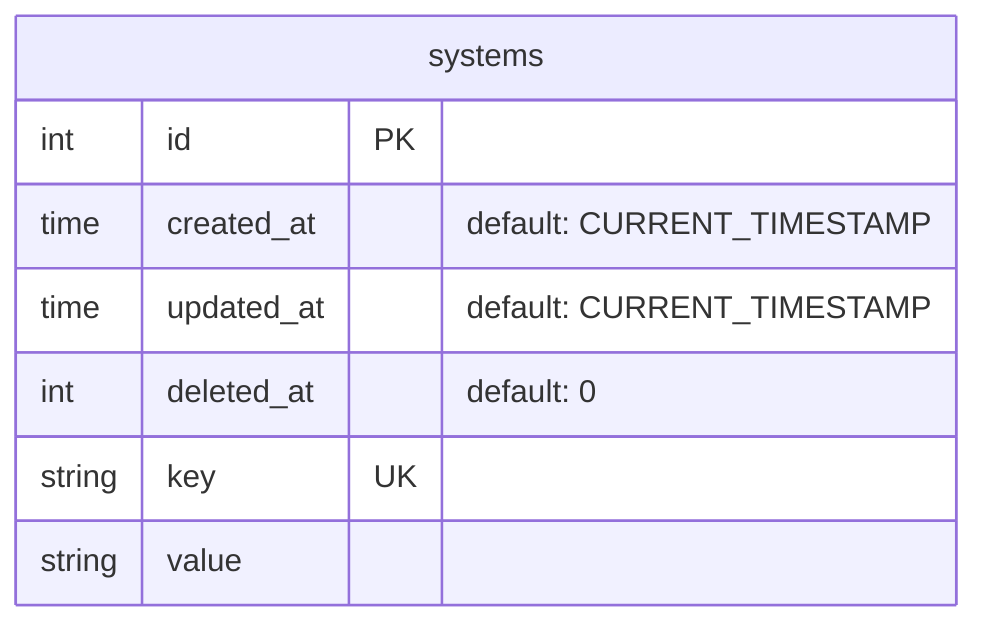

# AxonHub 数据库表结构

本文档按数据域列出全部 33 张表的字段与关系，用 Mermaid ER 图表示。只关心实体之间怎么关联、不需要字段时，看 [实体关系图（ERD）](erd.md)。

内容由 `internal/ent/migrate` 中 Ent 生成的目标 schema（`migrate.Tables`）导出，也就是 Atlas 生成版本化迁移时用来对比的那份定义。schema 变更后本文档不会自动更新，以 `internal/ent/schema/` 为准。

## 阅读说明

- 实线（`--`）表示数据库外键；虚线（`..`）表示逻辑关联：列里存的是另一张表的 ID，但数据库没有外键约束。
- `o|` 表示可为空（0 或 1），`||` 表示必填（恰好 1），`o{` 表示 0 到多。
- 字段标记 `PK` 为主键，`FK` 为外键列，`UK` 为唯一列。注释里的 `nullable` 表示可为空，`enum:` 后是枚举取值，`default:` 后是默认值，`logical ref` 表示逻辑关联列。
- 字段类型取自 Ent：`time` 为时间，`json` 为 JSON 列，`enum` 为枚举（数据库中以字符串存储）。
- 大多数业务表带有 `created_at`、`updated_at`，需要软删除的表带有 `deleted_at`（0 表示未删除）。
- 每个数据域图只画本域表发出的关联；被引用的其他域表只显示表名，不展开字段。

## 全局关系总览

只画表与表的关联，不含字段。

```mermaid
erDiagram
    projects ||--o{ api_key_profile_templates : project_id
    projects ||--o{ api_keys : project_id
    users o|--o{ api_keys : user_id
    channel_model_prices ||--o{ channel_model_price_versions : channel_model_price_id
    channels ||--o{ channel_model_prices : channel_id
    users o|--o{ channel_override_templates : user_id
    channels ||--o{ channel_probes : channel_id
    projects ||--o{ invitations : project_id
    users ||--o{ oidc_identities : user_id
    projects ||--o{ prompts : project_id
    channels ||--o| provider_quota_status : channel_id
    requests o|--o{ request_body_chunk_refs : request_id
    request_body_chunks ||--o{ request_body_chunk_refs : chunk_id
    request_executions o|--o{ request_body_chunk_refs : execution_id
    channels o|--o{ request_executions : channel_id
    data_storages o|--o{ request_executions : data_storage_id
    requests ||--o{ request_executions : request_id
    api_keys o|--o{ requests : api_key_id
    channels o|--o{ requests : channel_id
    data_storages o|--o{ requests : data_storage_id
    projects ||--o{ requests : project_id
    traces o|--o{ requests : trace_id
    projects o|--o{ roles : project_id
    projects ||--o{ threads : project_id
    projects ||--o{ traces : project_id
    threads o|--o{ traces : thread_id
    channels o|--o{ usage_logs : channel_id
    projects ||--o{ usage_logs : project_id
    requests ||--o{ usage_logs : request_id
    users ||--o{ user_projects : user_id
    projects ||--o{ user_projects : project_id
    users ||--o{ user_roles : user_id
    roles ||--o{ user_roles : role_id
    users o|..o{ requests : user_id
    users o|..o{ usage_logs : user_id
    api_keys o|..o{ usage_logs : api_key_id
    projects ||..o{ request_executions : project_id
    projects ||..o{ request_body_chunks : project_id
    roles o|..o{ invitations : role_id
    channels ||..o{ channel_model_price_versions : channel_id
    plugins ||..o{ plugin_schedules : installation_id
    plugins ||..o{ plugin_storages : installation_id
    plugin_schedules ||..o{ plugin_schedule_runs : schedule_id
    plugin_table_storages ||..o{ plugin_table_operations : storage_id
    plugins ||..o{ plugin_table_storages : plugin_id
```

## 身份与权限

用户、项目、成员关系、角色、API Key 以及登录和邀请。

## 渠道与模型

上游提供商渠道、模型定义、渠道定价及其历史版本、渠道探测和配额状态。

```mermaid
erDiagram
    channels {
        int id PK
        time created_at "default: CURRENT_TIMESTAMP"
        time updated_at "default: CURRENT_TIMESTAMP"
        int deleted_at "default: 0"
        enum type "enum: openai/openai_responses/atlascloud/cline/codex/vercel/anthropic/anthropic_aws/anthropic_gcp/gemini_openai/gemini/gemini_vertex/deepseek/deepseek_anthropic/deepinfra/qiniu/fireworks/doubao/doubao_anthropic/moonshot/moonshot_anthropic/zhipu/zai/zhipu_anthropic/zai_anthropic/anthropic_fake/openai_fake/openrouter/xiaomi/xiaomi_anthropic/xai/xai_responses/xai_subscription/ppio/siliconflow/volcengine/volcengine_anthropic/longcat/longcat_anthropic/minimax/minimax_anthropic/aihubmix/aihubmix_anthropic/burncloud/modelscope/bailian/bailian_responses/bailian_anthropic/moonshot_coding/jina/github/github_copilot/claudecode/cerebras/antigravity/nanogpt/nanogpt_responses/opencode_go/opencode_go_anthropic/ollama/ollama_anthropic/evolink/evolink_anthropic/groq/qiniu_anthropic/fenno/zenmux/zenmux_responses/zenmux_anthropic/zenmux_gemini/zenmux_video/commandcode/commandcode_anthropic/typesafe/cloudflare"
        string base_url "nullable"
        string name
        enum status "enum: enabled/disabled/archived; default: disabled"
        json credentials
        json disabled_api_keys "nullable"
        json supported_models
        json manual_models "nullable"
        bool auto_sync_supported_models "default: false"
        string auto_sync_model_pattern "nullable; default: ''"
        json tags "nullable"
        string default_test_model
        json policies "nullable"
        json settings "nullable"
        int ordering_weight "default: 0"
        string error_message "nullable"
        time auto_disabled_at "nullable"
        time auto_disable_expires_at "nullable"
        string remark "nullable"
        json endpoints "nullable"
    }
    models {
        int id PK
        time created_at "default: CURRENT_TIMESTAMP"
        time updated_at "default: CURRENT_TIMESTAMP"
        int deleted_at "default: 0"
        string developer
        string model_id
        enum type "enum: chat/embedding/rerank/image_generation/video_generation; default: chat"
        string name
        string icon
        string group
        json model_card
        json settings
        enum status "enum: enabled/disabled/archived; default: disabled"
        string remark "nullable"
    }
    channel_model_prices {
        int id PK
        time created_at "default: CURRENT_TIMESTAMP"
        time updated_at "default: CURRENT_TIMESTAMP"
        int deleted_at "default: 0"
        string model_id
        json price
        string reference_id UK
        int channel_id FK
    }
    channel_model_price_versions {
        int id PK
        time created_at "default: CURRENT_TIMESTAMP"
        time updated_at "default: CURRENT_TIMESTAMP"
        int channel_id "logical ref"
        string model_id
        json price
        enum status "enum: active/archived"
        time effective_start_at
        time effective_end_at "nullable"
        string reference_id UK
        int channel_model_price_id FK
    }
    channel_override_templates {
        int id PK
        time created_at "default: CURRENT_TIMESTAMP"
        time updated_at "default: CURRENT_TIMESTAMP"
        int deleted_at "default: 0"
        string name
        string description "nullable"
        string override_parameters
        json override_headers
        json header_override_operations "nullable"
        json body_override_operations "nullable"
        int user_id FK "nullable"
    }
    channel_probes {
        int id PK
        int total_request_count
        int success_request_count
        float64 avg_tokens_per_second "nullable"
        float64 avg_time_to_first_token_ms "nullable"
        int64 timestamp
        int channel_id FK
    }
    provider_quota_status {
        int id PK
        time created_at "default: CURRENT_TIMESTAMP"
        time updated_at "default: CURRENT_TIMESTAMP"
        int deleted_at "default: 0"
        enum provider_type "enum: claudecode/codex/antigravity/xai_subscription/github_copilot/nanogpt/cline/synthetic/neuralwatt/apertis/opencode_go/kimi_code/minimax/zhipu/zai/charm_hyper/zenmux/commandcode/deepseek/ollama"
        enum status "enum: available/warning/exhausted/unknown"
        json quota_data
        time next_reset_at "nullable"
        bool ready "default: true"
        time next_check_at
        string account_key "nullable; default: ''"
        int channel_id FK,UK
    }
    channel_model_prices ||--o{ channel_model_price_versions : channel_model_price_id
    channels ||--o{ channel_model_prices : channel_id
    users o|--o{ channel_override_templates : user_id
    channels ||--o{ channel_probes : channel_id
    channels ||--o| provider_quota_status : channel_id
    channels ||..o{ channel_model_price_versions : channel_id
```

## 请求与用量

客户端请求、对上游的每次执行、请求体去重分块、用量计费，以及 Thread/Trace 分组和载荷存储。

## Prompt

项目级 Prompt 以及全局的 Prompt 防护规则。

## 插件

插件安装、定时任务及其运行记录、插件 KV 存储和表存储。

## 系统配置

全局键值形式的系统设置。

## 逻辑关联（无外键约束）

以下列指向其他表，但数据库中没有外键。写入和删除时由业务代码保证一致性。

| 表.列 | 指向 | 可为空 |
|---|---|---|
| `requests.user_id` | `users.id` | 是 |
| `usage_logs.user_id` | `users.id` | 是 |
| `usage_logs.api_key_id` | `api_keys.id` | 是 |
| `request_executions.project_id` | `projects.id` | 否 |
| `request_body_chunks.project_id` | `projects.id` | 否 |
| `invitations.role_id` | `roles.id` | 是 |
| `channel_model_price_versions.channel_id` | `channels.id` | 否 |
| `plugin_schedules.installation_id` | `plugins.id` | 否 |
| `plugin_storages.installation_id` | `plugins.id` | 否 |
| `plugin_schedule_runs.schedule_id` | `plugin_schedules.id` | 否 |
| `plugin_table_operations.storage_id` | `plugin_table_storages.id` | 否 |
| `plugin_table_storages.plugin_id` | `plugins.plugin_id` | 否 |

## 表清单

| 表 | 数据域 | 字段数 | 关联到 |
|---|---|---|---|
| `users` | 身份与权限 | 13 | - |
| `projects` | 身份与权限 | 8 | - |
| `user_projects` | 身份与权限 | 7 | `projects`, `users` |
| `roles` | 身份与权限 | 8 | `projects` |
| `user_roles` | 身份与权限 | 5 | `roles`, `users` |
| `api_keys` | 身份与权限 | 13 | `projects`, `users` |
| `api_key_profile_templates` | 身份与权限 | 9 | `projects` |
| `oidc_identities` | 身份与权限 | 10 | `users` |
| `invitations` | 身份与权限 | 10 | `projects`, `roles` |
| `channels` | 渠道与模型 | 24 | - |
| `models` | 渠道与模型 | 14 | - |
| `channel_model_prices` | 渠道与模型 | 8 | `channels` |
| `channel_model_price_versions` | 渠道与模型 | 11 | `channel_model_prices`, `channels` |
| `channel_override_templates` | 渠道与模型 | 11 | `users` |
| `channel_probes` | 渠道与模型 | 7 | `channels` |
| `provider_quota_status` | 渠道与模型 | 12 | `channels` |
| `requests` | 请求与用量 | 31 | `api_keys`, `channels`, `data_storages`, `projects`, `traces`, `users` |
| `request_executions` | 请求与用量 | 29 | `channels`, `data_storages`, `projects`, `requests` |
| `request_body_chunks` | 请求与用量 | 5 | `projects` |
| `request_body_chunk_refs` | 请求与用量 | 5 | `request_body_chunks`, `request_executions`, `requests` |
| `usage_logs` | 请求与用量 | 26 | `api_keys`, `channels`, `projects`, `requests`, `users` |
| `traces` | 请求与用量 | 8 | `projects`, `threads` |
| `threads` | 请求与用量 | 6 | `projects` |
| `data_storages` | 请求与用量 | 10 | - |
| `prompts` | Prompt | 12 | `projects` |
| `prompt_protection_rules` | Prompt | 9 | - |
| `plugins` | 插件 | 16 | - |
| `plugin_schedules` | 插件 | 9 | `plugins` |
| `plugin_schedule_runs` | 插件 | 6 | `plugin_schedules` |
| `plugin_storages` | 插件 | 8 | `plugins` |
| `plugin_table_storages` | 插件 | 6 | `plugins` |
| `plugin_table_operations` | 插件 | 8 | `plugin_table_storages` |
| `systems` | 系统配置 | 6 | - |
